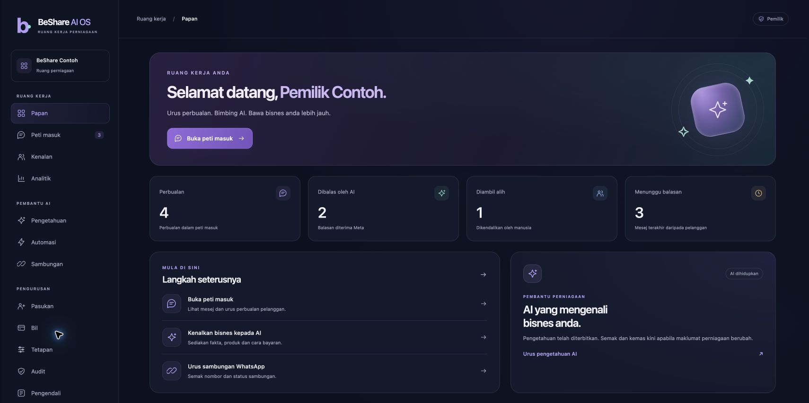

# BeShare AI OS Aurora interface

Implementation: `6acbdc5`, based on main `e75addc`.

The public WhatsApp landing page, account forms, workspace shell, dashboard,
inbox and connection page now share the Aurora visual style. Knowledge forms
and the platform-owner panel receive matching presentation styles. Existing
API operations, role checks, Meta signup, AI controls and backend files are
preserved.

## Validation

- JavaScript syntax and `git diff --check` pass.
- Existing auth-return, knowledge UI, signup event, signup launch and admin
  UI suites pass with synthetic APIs.
- Chrome visual checks covered login/signup, populated and empty dashboards,
  inbox and conversation, knowledge, connection statuses and the owner panel.
- Mobile widths 320 and 390, tablet width 768, and desktop width 1440 were
  checked where relevant. Checked pages had no horizontal document overflow.
- Light and dark themes, mobile menu dismissal with Escape, route focus and
  scroll reset, and staff access restrictions were checked.
- No browser console errors were recorded in the preview tabs.

The screenshot below uses synthetic names, messages, counts and connection
states. It is a local interface preview, not production account evidence.

## Release scope

This release changes six frontend files and includes the preview evidence.
It does not modify backend PHP, database migrations or account configuration.
Browser QA did not exercise real Meta messages or account mutations.
