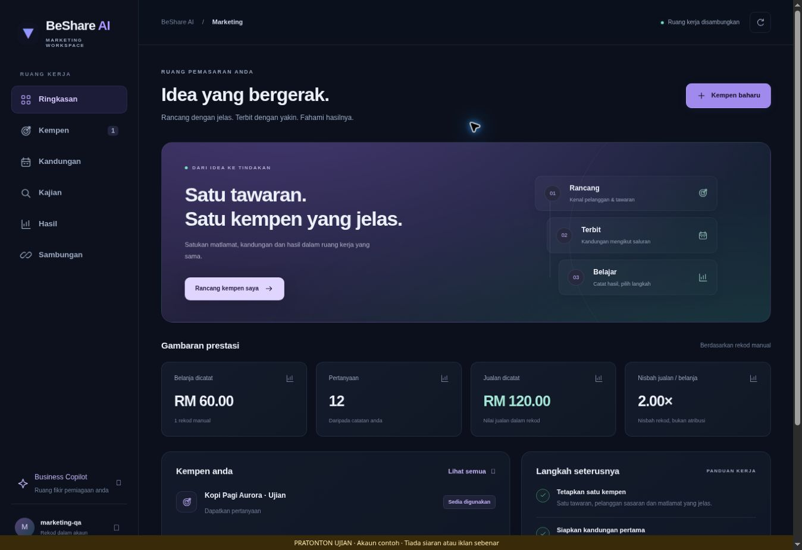

# Marketing v1 verification — 17 November 2026

## Browser verification

Tested the actual Marketing frontend against the actual account dispatcher and
Marketing CRUD modules, using a temporary SQLite database and a separate example
account. The preview clears social provider configuration and returns an explicit
unavailable response for AI. It never publishes content or spends on ads.

| Journey | Observed result |
| --- | --- |
| Three-step campaign creation | Offer, audience, destination, RM300 planned budget, dates and three channels saved successfully |
| Reload after save | The campaign was retrieved from the account database |
| Planned Facebook text content | Draft text and 20 November, 08:00 Malaysia time saved without publishing |
| Calendar | The saved plan appeared on 20 November with the `Dirancang` label |
| No connected provider | Scheduling remained disabled; each social connection showed its actual unconfigured state |
| Unavailable AI | The exact preview-service error appeared; no synthetic output was presented as an AI response |
| Research note | A manual observation and testable hypothesis saved against the campaign |
| Daily result | Example values saved and survived reload: RM60 spend, RM120 recorded sales, 12 enquiries, 4 orders |
| Calculated summary | The ratio was 2.00× with an explicit manual-record/attribution distinction |
| CSV export | A real browser download contained the correct headers, campaign name and example-data note |
| Desktop | Main workspace and editors rendered successfully |
| Phone-width layout | Tested in a 390×844 iframe in Chromium; bottom navigation and campaign modal were usable, with no horizontal document overflow |

The phone-width test verifies responsive layout; it is not a test on native iPhone
Safari. OAuth, real model quality and live provider delivery are not established
by this preview.

## Automated checks

- 84 Python account/SQLite and mocked-provider checks executed locally and passed.
- 15 Node checks passed, covering Marketing helpers, login return and existing
  Copilot draft helpers.
- JavaScript syntax and `git diff --check` passed.
- The OAuth return script's SHA-256 matches its CSP allowlist.
- PostgreSQL cases are enabled in the PR workflows against a disposable,
  explicitly guarded `copilot_kuota_test` database. Consult the proposed commit's
  workflow result for the executed PostgreSQL outcome.

The account suite checks authentication, owner isolation, identifier/reference
ownership, decimal amounts, optimistic concurrency, idempotent retries,
cross-account denial, daily-result uniqueness and publication status boundaries.
Mocked social tests cover encrypted credentials, OAuth state/candidate ownership,
actual granted permissions, pinned destinations, worker request markers and
ambiguous-delivery handling.

## Screenshot

All visible business names and numbers below are test data entered during QA.

## Release status

Source prepared in `codex/beshare-ai-marketing`. No production deployment,
provider connection, real social post, ad campaign or ad spend occurred.
The current session has GitHub access but no configured Hostinger MCP connection;
the actual deployed account image, secret configuration and worker supervision
have not been inspected. Release in the order described in `../README.md` after
those deployment dependencies are available.

The subsequent deployment-access check also found that Hostinger restricts
sign-in from the available cloud browser. No sign-in attempt or production change
followed that restriction. The additional release checklist and image preflight
prepare the next supported deployment session; they are not evidence of a live
installation.
